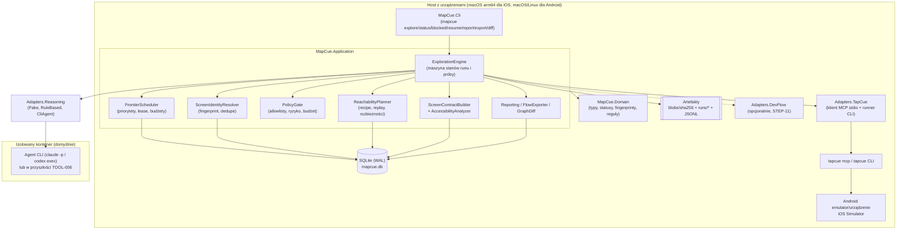
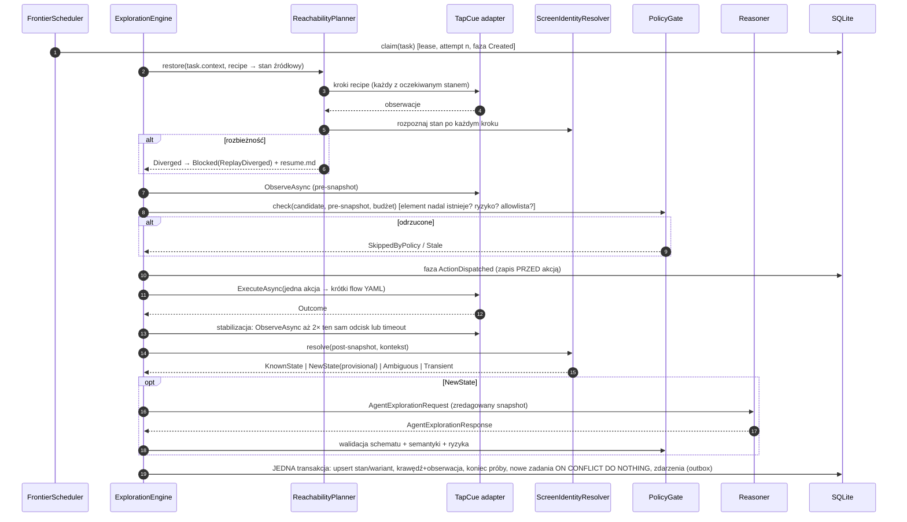
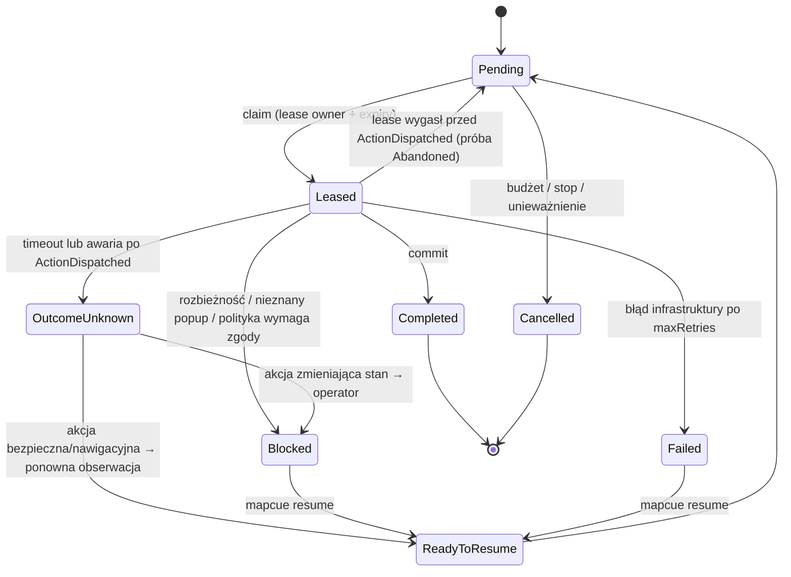
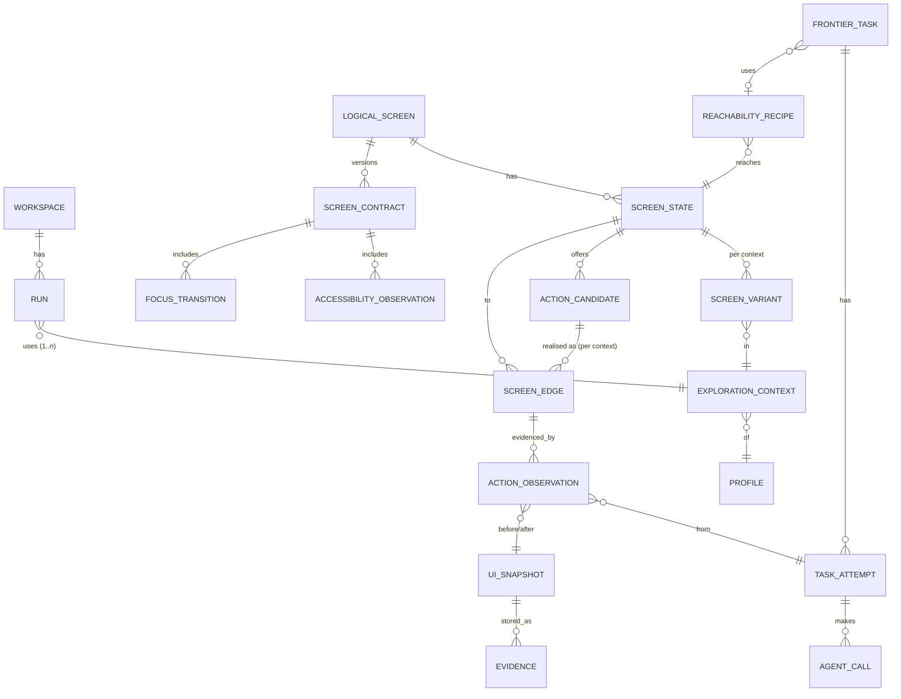
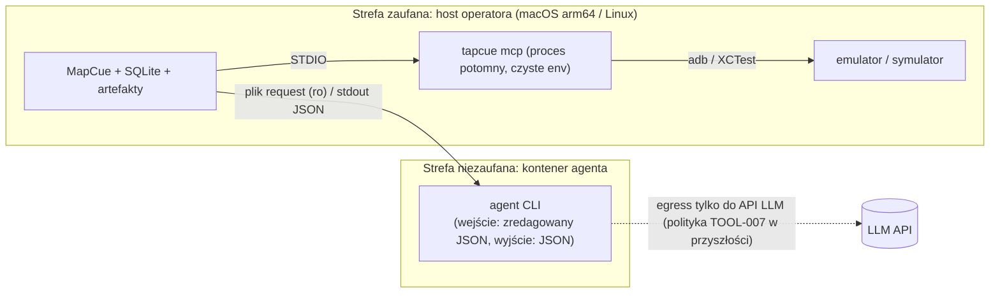

# MapCue — architektura (STEP-00)

Status: projekt wstępny, zatwierdzany razem z PR-00. Decyzje są w `docs/adr/`. Miejsca oznaczone **[PoC]** wymagają potwierdzenia w kodzie lub na urządzeniu we wskazanym etapie. Nazwy typów to propozycja, nie sztywne API.

Źródła wymagań: TOOL-009 i CAP-0104…CAP-0116 (`docs/sources.md`). Fakty o TapCue: `docs/tapcue-compatibility.md`.

## 1. Cel i zakres

MapCue to samodzielne CLI w .NET 10. Prowadzi deterministyczną, ograniczoną budżetem eksplorację aplikacji mobilnej (Android/iOS) przez TapCue. Buduje trwały **ScreenGraph** (ekrany logiczne, stany, warianty per kontekst, przejścia z dowodami). Dla każdego ekranu tworzy wersjonowany **ScreenContract** z macierzą dostępności. Eksportuje zweryfikowane ścieżki jako flow YAML TapCue.

MapCue buduje model aplikacji (crawler). Nie jest runnerem pojedynczych testów E2E ani kolejnym forkiem Maestro.

Poza zakresem MVP: analiza kodu MAUI (CAP-0116, P2), dashboard, praca rozproszona na wielu hostach, przechwytywanie WSS, własna platforma Dev Container (TOOL-007), silnik workflow (TOOL-010, DEC-015 niezatwierdzone).

## 2. Granice odpowiedzialności

| Komponent | Ma | Nie ma |
|---|---|---|
| **MapCue (orkiestrator)** | maszynę stanów runu i zadania, frontier, dedupe, budżety, politykę bezpieczeństwa, checkpointy, graf, kontrakty, raporty, eksport | sterowania urządzeniem poza TapCue, decyzji LLM o wykonaniu |
| **TapCue** | komunikację z urządzeniem, hierarchię UI, screenshoty, wykonanie flow YAML | wiedzy o grafie i polityce. MapCue nie modyfikuje TapCue i nie używa jego klas wewnętrznych. |
| **Reasoner (LLM)** | interpretację zapisanego snapshotu: nazwę i rodzaj stanu, kandydatów akcji, hipotezy warunków | stanu trwałego, dostępu do urządzenia (nie dostaje narzędzi TapCue, por. DEC-013), prawa do wykonania akcji |
| **Operator** | konfigurację (allowlisty, profile, budżety), rozwiązywanie blokad, zgody na ryzykowne kategorie | — |

## 3. Widok komponentów



Linie przerywane oznaczają integracje opcjonalne. Reasoner dostaje tylko zredagowane dane z `Blobs`/`Store`, nie urządzenie.

### 3.1 Projekty .NET (propozycja dla STEP-01)

```text
src/
  MapCue.Domain/                 bez zależności: identyfikatory, encje, statusy, fingerprint, reguły dedupe i polityki
  MapCue.Contracts/              DTO i JSON Schema (agent request/response, screen-contract, run manifest) z wersjami
  MapCue.Application/            silnik, scheduler, resolver, planner, porty (interfejsy)
  MapCue.Infrastructure.Sqlite/  IStateStore, migracje SQL
  MapCue.Infrastructure.Artifacts/ content-addressed store, JSONL journal, redakcja
  MapCue.Adapters.TapCue/        IDeviceAutomation: MCP stdio + CLI (hierarchy/test/check-syntax/--version)
  MapCue.Adapters.Reasoning/     IExplorationReasoner: Fake, RuleBased, CliAgent (kontener)
  MapCue.Adapters.DevFlow/       STEP-11, opcjonalny
  MapCue.Reporting/              raporty, eksport flow, diff map
  MapCue.Cli/                    host (System.CommandLine), DI, konfiguracja, walidacja
tests/
  MapCue.Domain.Tests, MapCue.Application.Tests, MapCue.Infrastructure.Tests,
  MapCue.Adapters.TapCue.ContractTests, MapCue.Contracts.Tests (schematy),
  MapCue.EndToEnd.Tests (FakeDevice), MapCue.Testing (FakeDevice + scenariusze aplikacji)
schemas/                         *.schema.json (źródło prawdy kontraktów, testowane)
samples/MapCue.DemoApp/          aplikacja kontrolna MAUI (STEP-02B, propozycja)
```

Zależności idą tylko do środka: `Cli → Adapters/Infrastructure → Application → Domain`. `Contracts` nie zależy od innych projektów.

## 4. Porty

```csharp
// Kształt orientacyjny; dokładne sygnatury w STEP-01/02/04.
interface IDeviceAutomation {                       // Adapters.TapCue
  Task<ToolVersion> GetVersionAsync(CancellationToken ct);
  Task<IReadOnlyList<DeviceInfo>> ListDevicesAsync(CancellationToken ct);
  Task<RawObservation> ObserveAsync(DeviceId d, ObservationRequest r, CancellationToken ct); // Fidelity: Fast(MCP) | Full(CLI)
  Task<ActionExecution> ExecuteAsync(DeviceId d, ValidatedDeviceAction a, CancellationToken ct); // jedna akcja
  Task<FlowRunResult> RunFlowAsync(DeviceId d, FlowFile f, FlowRunOptions o, CancellationToken ct); // replay/eksport
  Task<SyntaxCheckResult> CheckSyntaxAsync(FlowFile f, CancellationToken ct);
}
interface IExplorationReasoner {                    // Adapters.Reasoning
  Task<ReasonerResult> InterpretAsync(AgentExplorationRequest req, CancellationToken ct);
}
interface IStateStore { Task<T> InTransactionAsync<T>(Func<IUnitOfWork, Task<T>> work, CancellationToken ct); /* odczyty */ }
interface IArtifactStore { Task<ArtifactRef> PutAsync(Stream s, ArtifactKind k, RedactionInfo r, CancellationToken ct); }
interface IRedactor { RedactedContent Redact(Content c, RedactionContext ctx); }
interface ISecretResolver { SecretValue Resolve(SecretRef r); }   // np. secret://env/MAPCUE_DEMO_PASSWORD
interface IClock; interface IIdGenerator;                          // deterministyczne w testach
interface IHttpCaptureSource { /* STEP-11, opcjonalnie */ }
```

`ActionExecution.Outcome ∈ {Succeeded, Failed, TimedOut, OutcomeUnknown, Rejected}`. `OutcomeUnknown` oznacza, że akcja mogła zostać wykonana (timeout, zabity proces, zerwane STDIO).

## 5. Przebieg eksploracji

### 5.1 Pętla jednej próby (`ExploreAction`)



Zasady:

- **Jeden wykonawca UI na urządzenie** (wyłączna dzierżawa w SQLite). Analizy bez urządzenia (`AnalyzeState` na zapisanym snapshocie) mogą iść równolegle (CAP-0104).
- **Lokalność:** scheduler preferuje zadania, których stan źródłowy to bieżący stan urządzenia. Daje to DFS bez kosztu replay. Gdy takich nie ma, wybiera najkrótszy recipe (BFS po grafie) i priorytet nowości.
- Analiza agenta odbywa się raz na nowy stan w danym kontekście (`AnalyzeState`), a nie po każdej akcji. Znane stany i znane krawędzie nie wywołują LLM.

### 5.2 Typy zadań

| Typ | Urządzenie | Cel | Etap |
|---|---|---|---|
| `AnalyzeState` | nie (zapisany snapshot) | interpretacja przez reasoner i kandydaci akcji | 04/05 |
| `ExploreAction` | tak | wykonanie kandydata ze stanu w kontekście, obserwacja celu | 05 |
| `VerifyEdge` | tak | replay recipe od czystego startu, potwierdzenie celu i warunku końcowego | 06/10 |
| `AnalyzeScreen` | tak (pełna hierarchia) | ScreenContract: elementy, warianty | 08 |
| `AuditAccessibility` | tak / operator | macierz a11y i grafy fokusu dla jednej technologii | 08 |
| `AnalyzeSource` | nie | P2, poza MVP (CAP-0116) | — |

### 5.3 Maszyna stanów zadania



Fazy próby (journal, zapis przed efektem): `Created → RestoreStarted → RestoreVerified → PreObserved → PolicyChecked → ActionDispatched → ActionReturned → PostObserved → Classified → Committed`. Po restarcie decyzję o odzysku podejmuje się na podstawie ostatniej zapisanej fazy, nie sesji LLM (CAP-0109).

### 5.4 Run i zakończenie

`Created → Preflight → Running → Stopping → Finished(reason)`, gdzie `reason ∈ {Exhausted, BudgetExhausted, AllRemainingBlocked, StoppedByOperator, PreflightFailed, Failed}`.

- `Exhausted`: wszystkie osiągalne zadania w budżecie są w stanie końcowym. Raport podaje, że to wyczerpanie **odkrytego** grafu, a nie 100% funkcji (CAP-0112).
- `BudgetExhausted`: raport wymienia pozostały frontier z priorytetami, więc kolejny run może go kontynuować.
- Preflight sprawdza: wersję TapCue (`tapcue --version` ∈ `supportedVersions`), urządzenie z allowlisty, aplikację z allowlisty na pierwszym planie po `launchApp`, środowisko profilu = test, poprawność konfiguracji i sekretów (tylko referencje), wolne miejsce na artefakty.

### 5.5 Implementacja w STEP-05 (vertical slice)

`MapCue.Application/Exploration/ExplorationEngine` realizuje §5.1 bez lease i odzysku (STEP-06) i bez trwałych recipe (STEP-09):

- **Run:** tabela `runs` (migracja `0004`), `Created → Preflight → Running → Finished(reason)`; checkpoint i `runs/<runId>/run.json` przy zakończeniu. Preflight według §5.4: miejsce na dysku, wersja narzędzia (politykę wersji egzekwuje adapter TapCue przed każdą sesją), urządzenie, plik `setupFlow`, reset do stanu startowego profilu z aplikacją na pierwszym planie.
- **Frontier:** zadania w `frontier_tasks`; zaakceptowana akcja zadania `ExploreAction` (`ValidatedDeviceAction`, `elementKey`, oczekiwany `identityHash`) w `task_actions`, więc wykonanie nie zależy od sesji reasonera. Kolejność: najpierw `AnalyzeState`, potem `ExploreAction` najbliższe bieżącemu stanowi po znanych krawędziach (BFS), remisy w kolejności store (priorytet, głębokość, sekwencja). `back` ma niższy priorytet, więc stan jest eksplorowany przed jego opuszczeniem. Zadanie ze stanu na głębokości `d` tworzy ścieżkę `d + 1`, więc `d ≥ maxDepth` daje `Cancelled`.
- **Nawigacja i reset:** dojście do stanu źródłowego po krawędziach `observed`, deterministycznych, z zapisaną akcją. Każdy krok jest weryfikowany rozpoznaniem stanu. Przy braku ścieżki albo rozbieżności następuje reset (`setupFlow` przez `RunFlowAsync`, inaczej `launchApp`), a po nim jedna ponowna próba. Gdy i ona zawiedzie: `Blocked(ReplayDiverged)`.
- **Próba:** świeży pre-snapshot, rozpoznanie stanu tylko do odczytu, `PreExecutionGuard` (inny stan albo brak elementu: `Blocked(ElementStale)` z dowodem). Następnie zapis próby w fazie `ActionDispatched` przed akcją, jedna akcja, stabilizacja (`UiStabilizer`: 2 kolejne obserwacje z tym samym `identityHash` i bez dyskryminatora `loading`, najwyżej do `uiSettleTimeout`; liczba obserwacji ograniczona też bez upływu zegara) i `GraphCommitter.CommitAttemptAsync`. Wynik narzędzia jest dowodem `ToolOutput` próby.
- **Wyjście z aplikacji:** TapCue 0.1.0 nie podaje aplikacji na pierwszym planie, więc `AppPresenceDetector` wnioskuje z pakietów `resource-id`. Pakiet aplikacji oznacza `InApp`. Tylko inne pakiety (np. launcher) oznaczają `Left`. Same identyfikatory frameworka (`android:id/*`, np. `AlertDialog`) albo brak identyfikatorów dają `Unknown`, traktowane jak aplikacja. Po `Left` krawędź jest `executed` bez celu, a ekran spoza aplikacji jest dowodem próby, nie stanem grafu.
- **Wyniki akcji:** `OutcomeUnknown` daje status zadania `OutcomeUnknown` bez ponowienia i reset przed kolejnym zadaniem. `Failed`/`Rejected`/`TimedOut` dają `Failed`. Awaria obserwacji po wykonanej akcji też kończy się commitem (krawędź `executed`). Kolejne awarie urządzenia (`MaxConsecutiveDeviceFailures`) kończą run jako `Failed`.
- **Budżety:** `maxActions` (akcje, nawigacja i resety), `maxDuration`, `maxStates`/`maxScreens` (cały graf workspace), `maxDepth`. Reasoner korzysta z `AgentBudget` z sumą użycia całego workspace.
- **Zakończenie:** brak zadań `Pending` daje `Exhausted`; pozostałe zadania `Blocked` dają `AllRemainingBlocked`.
- **Determinizm:** identyfikatory grafu pochodzą z treści, identyfikatory prób z `(taskId, n)`, a `SeededIdGenerator` (`--seed`) ustala identyfikatory runu, zdarzeń i checkpointów.

## 6. Model danych (ScreenGraph)



| Typ | Kluczowe pola | Uwagi |
|---|---|---|
| `ExplorationProfile` | `profileId`, `platform`, `appId`, `appBuildId`, `environment` (`test` wymagane), `setupFlow` (flow operatora do stanu początkowego), `inputs` (referencje sekretów lub generatorów), `capabilities`, `allowedActionTypes`, `allowedRiskClasses`, `budgets`, `dataIsolation: disposable\|shared-readonly` | definiowany w YAML przez operatora. Bez rzeczywistych danych klientów (CAP-0105). |
| `ExplorationContext` | `contextId`, `signature = H(profileId, platform, appBuildId, locale, scenarioId, sorted(capabilities))` | jeden run może mieć wiele kontekstów, ale każda próba ma dokładnie jeden |
| `LogicalScreen` | `screenId`, `screenKey`, `displayName`, `identityStatus: provisional\|confirmed`, `identitySource: hint\|structure\|operator` | `displayName` może pochodzić od agenta, ale tożsamość nadaje resolver |
| `ScreenState` | `stateId`, `screenId`, `stateKind` (`default, loading, empty, error, modal, menu, form, keyboard, unknown`), `identityHash`, `fingerprintVersion` | bez kontekstu: wspólny dla profili |
| `ScreenVariant` | `(stateId, contextId)`, `elementSetHash`, różnica elementów względem bazy, `evidenceIds` | dane i dowody wariantu są zawsze w kontekście |
| `UiSnapshot` | `snapshotId`, `attemptId`, `fidelity: fast\|full`, `rawRef`, `normalizedRef`, `identityHash`, `layoutHash`, `screenshotRef?`, `redactionVersion` | surowy snapshot zostaje (zredagowany), więc fingerprint można przeliczyć po zmianie wersji |
| `UiElement` (znormalizowany) | `elementRef` (w snapshocie, np. `e17`), `elementKey` (stabilny w ekranie), `role`, `label`, `text`, `resourceId`, `flags`, `boundsBucket`, `listTemplate?` | role na iOS: `inferred` (G-03) |
| `ActionCandidate` | `actionKey = H(actionType, canonicalSelector, paramClass)`, `source: agent\|rule`, `riskClass`, `status` | `paramClass` to np. `input:profile.username`, nigdy wartość |
| `ScreenEdge` | `(fromStateId, actionKey, contextId) → toStateId`, `status`, `observationCount`, `nondeterministic`, `lastVerifiedAt` | wiele różnych celów oznacza flagę `nondeterministic` i brak eksportu |
| `ActionObservation` | `attemptId` (UNIQUE), `before`, `after`, `outcome`, `durationMs`, `evidenceIds` | jedna obserwacja na próbę, co daje idempotencję commitu |
| `FrontierTask` | `taskKey` (UNIQUE), `type`, `status`, `priority`, `depth`, `contextId`, `fromStateId`, `actionKey`, `recipeId`, `leaseOwner`, `leaseExpiresAt`, `blockedReason` | |
| `TaskAttempt` | `attemptId`, `n`, `phase`, `outcome`, `error`, `artifactsDir` | |
| `ReachabilityRecipe` | `recipeId`, `contextId`, `targetStateId`, `steps[]` (reset, setupFlow, akcje z oczekiwanym stanem i warunkiem końcowym), `verifiedAt`, `basedOnEdges` | budowany z grafu, bez LLM |
| `BlockedReason` | `code` (`ReplayDiverged, UnknownOverlay, PolicyRequiresApproval, ElementStale, AmbiguousIdentity, DeviceUnavailable, OutcomeUnknownUnsafe, AppLeft, Crash, BudgetForTask`), `details`, `evidenceIds`, `resumeDoc` | |
| `Checkpoint` | `runId`, `eventSeq`, statystyki frontier, hash konfiguracji | punkt odniesienia dla `resume` i raportu |
| `ScreenContract` | `screenId`, `version`, `contentHash`, `elements`, `variants`, `accessibility`, `keyboard`, `evidence`, `appBuildId`, `platform`, `locale` | nowa wersja tylko przy zmianie `contentHash` |
| `AccessibilityObservation` | `elementKey`, `platform`, `technology: VoiceOver\|TalkBack\|Keyboard`, `property`, `value`, `evidenceLevel`, `method`, `evidenceRef` | |
| `FocusTransition` | `stateId`, `contextId`, `technology`, `from`, `to`, `order`, `evidenceLevel`, `method` | |
| `AgentCall` | `requestId`, `schemaVersion`, `provider`, `model`, `tokensIn/Out`, `cost` (lub `unknown`), `validation`, `requestRef`, `responseRef` | |

## 7. Tożsamość ekranu, fingerprint i klucze dedupe

Fingerprint **nie zależy od hasha screenshotu** ani od pikseli. Powstaje z zredagowanego, znormalizowanego drzewa. Każdy hash ma `fingerprintVersion`, więc po zmianie algorytmu można przeliczyć całą historię z zapisanych snapshotów.

### 7.1 Normalizacja snapshotu

1. Usunięcie UI systemowego (pasek statusu, klawiatura systemowa, nakładki spoza `appId`), zgodnie z regułami per platforma. **[PoC STEP-02]**: co TapCue zwraca z okien systemowych.
2. Maskowanie treści dynamicznych w tekstach do celów tożsamości: cyfry → `#`, wzorce dat, godzin, kwot, e-maili, IBAN → tokeny, wartości wejść profilu → `‹input›`. Tekst oryginalny (zredagowany) zostaje w dowodzie.
3. Wykrycie list: kontener `scrollable` albo ≥ 3 sąsiednie poddrzewa o tym samym kształcie. Taka lista jest reprezentowana jako `list(templateHash, countBucket ∈ {0, 1, many})`. Dzięki temu „pusta” i „z danymi” to różne stany, a 3 i 7 pozycji to ten sam stan.
4. Wyznaczenie `elementKey`: kolejno `resourceId`, potem `role + label znormalizowany`, a gdy brak obu, `role + ścieżka strukturalna` (oznaczony jako słaby klucz).

### 7.2 Hashe

- `identityHash = SHA-256(posortowany multizbiór {elementKey elementów interaktywnych} ∪ {kotwice: tytuły, elementy z resourceId} ∪ {list templates} ∪ {stateKind discriminators})`. Kolejność nie wpływa na tożsamość.
- `layoutHash = SHA-256(uporządkowana lista elementów)`. Służy do kontraktu, kolejności i diffów, nie do tożsamości.
- `contextSignature`: §6. Kontekst **nie** wchodzi do tożsamości stanu, tylko do wariantu, krawędzi i zadań.

### 7.3 Rozpoznanie stanu (deterministyczne)

1. `identityHash` równy znanemu stanowi oznacza **KnownState**.
2. Podobieństwo Jaccarda kotwic do znanego stanu ≥ `τ_state` (domyślnie 0,85), bez różnicy dyskryminatorów `stateKind`, oznacza **KnownState z wariantem** (zapis różnicy elementów).
3. Dopasowanie `screenHints` z konfiguracji (np. regex `resourceId` strony, MAUI `AutomationId` korzenia: **[PoC STEP-02B]**) albo Jaccard ≥ `τ_screen` (0,6) z nakładką lub zmianą `stateKind` oznacza **nowy ScreenState istniejącego LogicalScreen**.
4. Brak dopasowania oznacza **nowy LogicalScreen** (`provisional`).
5. Dwa kandydaty w odległości < ε oznaczają **Ambiguous**: zapis obu hipotez, stan `provisional`, bez cichego scalania. Scalenie robi operator (`mapcue graph merge`, P1).
6. Snapshot niestabilny (odcisk zmienia się w oknie stabilizacji) albo ze wskaźnikiem ładowania oznacza **Transient**: ponowna obserwacja do `uiSettleTimeout`, potem stan `loading` z flagą.

**STEP-05 (kalibracja na demo app, R-04):** fingerprint w wersji 2 pomija kontenery frameworka (`android:id/content` i kontenery MAUI `action_bar_root`, `navigation_layout`, `navigationlayout_content`, `nav_host`) jako kotwice tożsamości. Krok 3 działa przez `identity.screenHints` (wzorce `resource-id` znacznika ekranu, dla MAUI `AutomationId` tytułu strony). Szczegóły: ADR-0006.

Agent może zaproponować nazwę i „to jest ten sam ekran co X”. Taka propozycja trafia do bazy jako hipoteza (`inferred`) i nie zmienia tożsamości.

### 7.4 Klucze dedupe (CAP-0107)

| Obiekt | Klucz | Efekt |
|---|---|---|
| Zadanie `ExploreAction` | `H(type, fromStateId, actionKey, contextSignature, scenarioId, appBuildId)` | `INSERT … ON CONFLICT(task_key) DO NOTHING`. Cykl A→B→A zapisuje krawędź, ale nie tworzy zadania dla znanej pary. |
| Zadanie `AnalyzeState` | `H(type, stateId, contextSignature, appBuildId, reasonerPromptVersion)` | jedna analiza stanu na kontekst i build |
| Krawędź | `(fromStateId, actionKey, contextId)` | kolejne obserwacje zwiększają licznik i mogą podnieść status (monotonicznie) |
| Obserwacja | `attemptId` | podwójny commit tej samej próby jest niemożliwy |
| Ponowne utworzenie zadania | tylko przy zmianie `appBuildId`, kontekstu, po `Blocked`/`Failed` przez `resume`, albo przy jawnej reweryfikacji | zgodnie z CAP-0107 |

Ochrona przed pętlą w obrębie próby: replay i stabilizacja mają limit kroków. Powtórzenie stanu w bieżącej ścieżce recipe oznacza błąd planera (`ReplayLoop`), wykrywany przed wyczerpaniem budżetu.

## 8. Weryfikacja i poziomy pewności

### 8.1 Status krawędzi (raport: odkryte / zaobserwowane / wykonane / zweryfikowane / zablokowane / nieznane)

| Status | Znaczenie | Warunek |
|---|---|---|
| `discovered` | kandydat istnieje | agent albo reguła go zaproponowały, nikt go nie wykonał |
| `executed` | akcja wykonana | TapCue zwrócił `Succeeded`, ale celu nie sklasyfikowano jednoznacznie |
| `observed` | cel rozpoznany raz | resolver zwrócił stan po stabilizacji |
| `verified` | cel potwierdzony deterministycznie | `observed` + warunek końcowy (`assertVisible` kotwic celu przez TapCue) + co najmniej `verification.minReplays` (domyślnie 1) udanych replay recipe od czystego startu |
| `blocked` | nie da się dokończyć | `BlockedReason` |
| `skippedByPolicy` | polityka zabroniła | kategoria ryzyka, allowlista |
| `unknown` | skutek nieznany | `OutcomeUnknown` |

Eksport do TapCue YAML obejmuje **tylko** ścieżki, w których wszystkie krawędzie są `verified`, deterministyczne i w tym samym kontekście.

### 8.2 Poziom pewności twierdzeń (kontrakty, raporty)

`observed` (zobaczone w działającej aplikacji), `inferred` (wniosek: agent, heurystyka, drzewo), `verified` (potwierdzone wykonaniem lub testem z dowodem), `unsupported` (metoda niedostępna na tej platformie lub w tym narzędziu), `blocked` (próba była, ale się nie udała), `notTested`. Każde twierdzenie w `ScreenContract` i raporcie ma poziom i `evidenceIds`.

## 9. Kontrakt z agentem (CAP-0108)

Schematy w `schemas/` (STEP-04) w JSON Schema 2020-12, z `additionalProperties: false`. Wersja jest w polu `schemaVersion` i w nazwie pliku. Poniżej szkic, nienormatywny.

### 9.1 `AgentExplorationRequest` (`mapcue.agent-exploration-request/1`)

```json
{
  "schemaVersion": "mapcue.agent-exploration-request/1",
  "requestId": "req_01J…",
  "task": { "taskId": "T-0007", "attemptId": "A-0007-1", "type": "AnalyzeState" },
  "snapshot": {
    "snapshotHash": "sha256:…",
    "platform": "android",
    "elements": [
      { "ref": "e3", "role": "button", "label": "Accounts", "resourceId": "AccountsTab",
        "flags": ["clickable", "enabled"], "region": "bottom", "parent": "e1" }
    ],
    "screenshot": null
  },
  "context": { "profileAlias": "investor", "capabilities": ["investments"], "locale": "pl-PL" },
  "graphHints": {
    "candidateStates": [{ "stateId": "S-12", "displayName": "Home", "similarity": 0.72 }],
    "knownActionKeys": ["ak:tap:id=AccountsTab"]
  },
  "policy": {
    "allowedActionTypes": ["tap", "back", "scroll", "inputText", "swipe"],
    "forbiddenRiskClasses": ["destructive", "financial", "communication", "accountChange", "external"]
  },
  "limits": { "maxCandidates": 20 },
  "instructions": "Interpret the screen. Propose actions using element refs only. Separate facts from hypotheses."
}
```

Do LLM nie trafiają: sekrety, wartości `inputs`, tokeny, pełne payloady HTTP, surowe identyfikatory klientów. Screenshot jest domyślnie wyłączony (`agent.sendScreenshots: false`). Po włączeniu trafia tylko po redakcji (P1).

### 9.2 `AgentExplorationResponse` (`mapcue.agent-exploration-response/1`)

```json
{
  "schemaVersion": "mapcue.agent-exploration-response/1",
  "requestId": "req_01J…",
  "snapshotHash": "sha256:…",
  "interpretation": {
    "proposedScreenName": "Home",
    "stateKind": "default",
    "sameAsStateId": null,
    "confidence": 0.8
  },
  "facts": [
    { "claim": "Bottom tab bar with 4 tabs", "elementRefs": ["e3", "e4", "e5", "e6"], "level": "observed" }
  ],
  "hypotheses": [
    { "claim": "Investments tab requires capability investments", "kind": "guard",
      "guard": { "all": [{ "capability": "investments" }] }, "level": "inferred", "confidence": 0.6 }
  ],
  "actionCandidates": [
    { "candidateId": "c1", "elementRef": "e3", "actionType": "tap", "intent": "Open accounts",
      "riskClass": "navigational", "expectedOutcome": "Accounts list", "confidence": 0.9 },
    { "candidateId": "c2", "elementRef": "e9", "actionType": "inputText",
      "input": { "valueRef": "profile.inputs.username" }, "riskClass": "stateChanging", "confidence": 0.7 }
  ],
  "warnings": []
}
```

### 9.3 Walidacja (kolejność, każda porażka jest zapisywana)

1. Parsowanie JSON i zgodność z JSON Schema (`additionalProperties: false`, enumy, limity długości). Dopuszczalna jedna naprawa formatu (re-prompt), zgodnie z TOOL-006 CAP-0068.
2. `requestId` i `snapshotHash` muszą być zgodne z żądaniem. Inaczej odpowiedź jest **stale** i zostaje odrzucona.
3. Semantyka: `elementRef` istnieje w snapshocie; `actionType` jest w polityce; `inputText` tylko z `valueRef` do `profile.inputs.*` albo z generatora deterministycznego (`generated:email`); brak pól z YAML, komendami, ścieżkami, URL.
4. Ryzyko: `effectiveRisk = max(agent.riskClass, ruleRisk(element))`. `ruleRisk` to deterministyczny klasyfikator słów kluczowych w wielu językach (por. AppScreenMap) oraz reguł operatora (`deny` po `resourceId`/regex). Klasa spoza `allowedRiskClasses` daje `skippedByPolicy` albo `PolicyRequiresApproval`.
5. Mapowanie na typowaną `ValidatedDeviceAction` (selektor kanoniczny wybiera MapCue: `id` przed tekstem).
6. Tuż przed wykonaniem: ponowny pre-snapshot. Element musi nadal istnieć i stan musi być ten sam (`identityHash`). Inaczej `ElementStale`.

Hipotezy (np. `guard`) zapisuje się jako `inferred`. Status `observed` dostają dopiero po obserwacji na profilach, które je rozróżniają (CAP-0106).

### 9.4 Adaptery reasonera

| Adapter | Kiedy | Uwagi |
|---|---|---|
| `DeterministicFakeReasoner` | testy | odpowiedzi ze skryptu po `snapshotHash`/regule |
| `RuleBasedReasoner` | tryb offline, bazowy | heurystyki bez LLM (wszystkie klikalne elementy, priorytety nawigacji). Pozwala uruchomić MVP bez LLM i daje punkt odniesienia kosztu. |
| `CliAgentReasoner` | realny LLM | `claude -p` / `codex exec` ze schematem wyjścia **[PoC STEP-04: flagi CLI]**. Domyślnie w izolowanym kontenerze bez dostępu do urządzeń i repo. Lokalnie tylko przy `agent.runtime: local` **i** `agent.allowLocalExecution: true`. Brak automatycznego fallbacku na host. |
| `Tool006GatewayReasoner` | przyszłość | po dostępności TOOL-006 (`AgentRequest<T>` → `AgentResult<T>`). Stan zadania zostaje w MapCue (DEC-010). |

### 9.5 Implementacja w STEP-04

- **Schematy:** `schemas/agent-exploration-request.v1.schema.json`, `…-response.v1.schema.json` (2020-12, każdy obiekt `additionalProperties: false`, wszystkie pola wymagane, teksty bez znaków sterujących i z limitem długości). Osadzone w `MapCue.Contracts`. MapCue waliduje własnym walidatorem podzbioru 2020-12 (`MapCue.Contracts.Schemas.JsonSchema`, bez zależności; nieznane słowo kluczowe schematu = błąd przy ładowaniu, zduplikowane klucze JSON = odpowiedź niepoprawna). Testy porównują jego werdykty z JsonSchema.Net.
- **`snapshotHash`** = `UiSnapshot.NormalizedSha256` (hash zapisanego, znormalizowanego dokumentu). `elementRef` są ważne tylko w tym dokumencie, więc `identityHash` (ignoruje kolejność) nie wystarcza do kontroli stale. Tuż przed wykonaniem (`PreExecutionGuard`, STEP-05) porównywany jest `identityHash` świeżego snapshotu i obecność elementu po `elementKey`.
- **Żądanie** (`AgentRequestBuilder`): tylko elementy interaktywne lub z etykietą/`resource-id` (maks. 400), etykiety **zamaskowane** (liczby, kwoty, daty, wartości wejść), bez oryginalnych tekstów, wartości wejść, sekretów i screenshotów. Żądanie przechodzi przez `IArtifactStore.PutTextAsync` (redakcja) i do reasonera trafia dokładnie zapisany tekst; jeśli redakcja zepsuje schemat, nic nie jest wysyłane. `requestId` jest deterministyczny (`task`, `attempt`, `snapshotHash`, wersja promptu `mapcue.agent-prompt/1`).
- **Walidacja** (`AgentResponseValidator`): rozmiar ≤ 256 KiB → JSON + schemat → stale (`requestId`, `snapshotHash`) → treść zakazana w dowolnym tekście (YAML/komendy Maestro, komendy powłoki, ścieżki, URL: odrzucenie całej odpowiedzi) → per kandydat: limit, unikalność, typ w allowliście, `elementRef` istnieje, jest interaktywny i włączony, `inputText` tylko do pola tekstowego i tylko z `profile.inputs.<wejście profilu>` lub generatora (`email|name|text|number`), kierunek tylko dla `scroll/swipe` → ryzyko `max(agent, RiskClassifier)` → `PolicyGate` → `ValidatedDeviceAction` z selektorem MapCue (`resource-id`, potem tekst, każdy tylko jeśli **unikalny** na ekranie; wiersze list z tym samym id idą po tekście).
- **Naprawa formatu:** tylko dla `SchemaInvalid` (także nieczytelne wyjście CLI), najwyżej jedna, z listą błędów walidatora (nazwy pól spoza `[A-Za-z0-9_]` nie są cytowane). Odpowiedzi stale i z treścią zakazaną nie są naprawiane.
- **Zapis:** każde wywołanie to `AgentCall` (tabela `agent_calls`, migracja `0003`) z hashami artefaktów żądania i odpowiedzi, statusem, błędami, decyzjami per kandydat i zużyciem, w jednej transakcji z kandydatami (`ActionCandidate`, `CandidateSource.Agent`; `Proposed` albo `SkippedByPolicy`) i zdarzeniem `agent.call`.
- **Budżety** (`AgentBudget`): sprawdzane przed wywołaniem (z estymatą tokenów żądania); brak raportu tokenów = estymata ~4 B/token, brak kosztu = licznik `unknownCostCalls`. Przekroczenie: `Blocked(ReasonerBudgetExhausted)`. Niedostępny reasoner: `Blocked(ReasonerUnavailable)`, bez ponowienia.
- **`CliAgentReasoner` [PoC potwierdzony dla Claude Code 2.1.310]:** `claude -p --output-format json --json-schema <schemat bez $schema/$id> --system-prompt … --tools "" --strict-mcp-config --disable-slash-commands --no-session-persistence [--bare] [--model]`, żądanie na stdin, odpowiedź z `structured_output` albo `result`. Kontener: `docker|podman run --rm -i --read-only --tmpfs /tmp --cap-drop ALL --security-opt no-new-privileges --pids-limit 256 --memory 1g --cpus 1`, **bez wolumenów** (żądanie przez stdin, więc ostrzej niż „plik ro” z ADR-0004), klucz API tylko po nazwie zmiennej, po timeoucie `kill` kontenera. `local`: czyste środowisko (`PATH`, `HOME`, `USER`, `LANG`, `TMPDIR`), pusty katalog roboczy. Brak fallbacku między runtime'ami.

## 10. Polityka bezpieczeństwa i budżety

### 10.1 Warstwy

1. **Allowlisty (preflight i każda akcja):** `appIds`, `deviceIds` (albo wzorce), `environments` (`test`), `profileIds`. Każda akcja sprawdza, że aplikacja z allowlisty jest na pierwszym planie. Wyjście poza aplikację daje `AppLeft` i relaunch.
2. **Typy akcji:** domyślnie `tap, back, scroll, swipe, inputText(valueRef), hideKeyboard, waitForAnimationToEnd`. `longPress`, `point`, `openLink`, `setPermissions` wymagają jawnej zgody w profilu.
3. **Klasy ryzyka:** `safe, navigational, stateChanging, destructive, financial, communication, accountChange, external, unknown`. Domyślnie dozwolone `safe, navigational`, a `stateChanging` tylko przy `dataIsolation: disposable`. Reszta jest zabroniona bez jawnej polityki **i** profilu testowego z danymi jednorazowymi. `unknown` traktuje się jak `stateChanging`.
4. **Generator YAML:** szablony per typ akcji, wartości escapowane, sekcja `appId` z allowlisty, zakaz komend z `tapcue-compatibility.md` §2.3. Każdy plik przechodzi `check-syntax` przed wykonaniem (w STEP-02 trzeba zmierzyć koszt: to osobny proces JVM, więc można cache'ować po hashu szablonu).
5. **Brak auto-retry skutków:** retry dotyczy tylko infrastruktury przed `ActionDispatched` albo akcji `safe/navigational`. Akcja zmieniająca stan z `OutcomeUnknown` przechodzi do operatora (CAP-0109).
6. **Produkcja:** profil musi mieć `environment: test`. Konfiguracja bez `allowedEnvironments` odmawia startu. MapCue nie ma trybu „prod”.

### 10.2 Budżety (konfiguracja; wartości domyślne bezpieczne)

| Budżet | Domyślnie | Zakres |
|---|---|---|
| `maxDepth` | 8 | długość ścieżki od stanu startowego |
| `maxScreens` / `maxStates` | 40 / 120 | |
| `maxActions` | 300 | wykonane akcje urządzenia na run |
| `maxDuration` | 60 min | |
| `maxRetries` | 2 | tylko infrastruktura |
| `maxListRowsPerTemplate` | 2 | reszta wierszy jako `representedBy` |
| `uiSettleTimeout` / `actionTimeout` / `observeTimeout` | 5 s / 30 s / 20 s | twarde timeouty z zabiciem procesu |
| `agent.maxCalls` / `agent.maxTokens` / `agent.maxCostUsd` | 100 / 1 000 000 / 5 | nieznany koszt jest liczony jako `unknown`, a limit tokenów działa nadal |

Przekroczenie budżetu zatrzymuje pobieranie nowych zadań, kończy bieżącą próbę i ustawia `BudgetExhausted`.

### 10.3 Sekrety i redakcja

- Sekrety są tylko referencjami (`secret://env/NAME`). Wartość rozwiązuje się w momencie wykonania i przekazuje do TapCue przez `env` (`${MAPCUE_IN_1}` w YAML). Plik YAML w artefaktach nie zawiera wartości.
- Proces `tapcue mcp` startuje z oczyszczonym środowiskiem (bez dziedziczonych `MAESTRO_*`, luka G-06). Wynik `run` jest redagowany przed zapisem.
- Redakcja przed trwałym zapisem: znane wartości sekretów i wejść, wzorce (e-mail, telefon, IBAN, PAN, tokeny `Bearer`/JWT), pola haseł. Screenshoty: maskowanie prostokątów pól oznaczonych jako wrażliwe (P1). Do tego czasu `recording.screenshots` dotyczy tylko profili z danymi syntetycznymi, z ostrzeżeniem w raporcie.
- Logi strukturalne bez wartości wrażliwych (redaktor w pipeline logowania, STEP-01).

## 11. Granica zaufania i środowisko wykonania



- Wyjście agenta jest niezaufane i przechodzi pełną walidację (§9.3). Agent nie ma tokenów do urządzeń, repozytorium ani sekretów profilu.
- iOS Simulator działa tylko na macOS. Nie zakłada się sterowania iOS z kontenera Linux. Gdy MapCue kiedyś będzie działać w kontenerze, potrzebny jest hostowy, autoryzowany broker MCP (allowlista operacji, uwierzytelnienie, audyt). Port `IDeviceAutomation` jest na to przygotowany (adapter `RemoteBroker`), ale **MVP go nie implementuje**. Granica jest opisana w ADR-0001.
- Jedna instancja MapCue na workspace: blokada pliku `.mapcue/lock` i dzierżawa urządzenia w SQLite.

## 12. Trwałość i artefakty

- **SQLite (WAL)** jest źródłem prawdy (ADR-0003). Migracje SQL są numerowane, a tabela `schema_migrations` przechowuje wersje. Kontrakty JSON mają własne `schemaVersion`.
- **Jedna transakcja na commit próby**: upsert stanu/wariantu, krawędź i obserwacja, koniec próby, nowe zadania (`ON CONFLICT DO NOTHING`), zdarzenia w tabeli `events` (outbox). `events.jsonl` to eksport z outboxa, nie drugie źródło prawdy.
- **Artefakty** zapisuje się przed commitem: content-addressed `blobs/sha256/..`, plik tymczasowy, `fsync`, rename. Baza odwołuje się tylko do zapisanych blobów. Bloby bez odwołań usuwa `mapcue gc`.

```text
.mapcue/                                 workspace (konfigurowalny, w .gitignore)
  mapcue.db                              SQLite
  lock
  blobs/sha256/ab/<hash>                 zredagowane snapshoty, screenshoty, odpowiedzi
  runs/<runId>/
    run.json                             manifest: wersje MapCue/TapCue, hash konfiguracji, profile, budżety
    events.jsonl
    tasks/<taskId>/task.json, resume.md
      attempts/<n>/attempt.json, action.yaml, tapcue-result.json, agent-request.json, agent-response.json  (linki do blobów)
    reports/coverage.json, coverage.md, graph.mmd, graph.json, blocked.md
  screens/<screenKey>/screen-contract.v<k>.json, variants.json, accessibility/{android,ios,voiceover-focus,talkback-focus,keyboard-focus,findings}.json
  exports/flows/<recipeId>.yaml          tylko zweryfikowane ścieżki
```

## 13. Wznawianie i handoff operatora (CAP-0109)

- Restart procesu: przy starcie run w `Running` przechodzi rekoncyliację lease (§5.3). Ukończone zadania zostają nietknięte.
- `resume.md` generuje się deterministycznie z bazy (bez LLM): Goal, Context/profil, Last verified state, Expected, Actual (ze ścieżką do dowodu), Completed actions, Problem (`BlockedReason`), Resume procedure (recipe + kroki), Constraints (zakazy z polityki), komenda `mapcue resume <taskId> [--approve <category>]`.
- `ReachabilityRecipe` odtwarza stan od czystego startu: `launchApp (clearState wg profilu) → setupFlow profilu → akcje krawędzi`. Każdy krok ma oczekiwany stan. Rozbieżność zatrzymuje replay i daje `ReplayDiverged` z dowodem. Recipe nie zależy od sesji LLM.

## 14. ScreenContract i accessibility (CAP-0113…0115)

- Model elementów i wariantów (`elementKey`, `ScreenVariant`) powstaje już w STEP-03, więc graf nie wymaga przebudowy (transkrypt: Structure i Variant Analyzer to P0). Artefakty kontraktu i a11y powstają w STEP-08.
- Kontrakt pochodzi z pełnej hierarchii (`fidelity: full`) i obserwacji wariantów. Elementy mają `visibleWhen` tylko jako hipotezy `inferred`, dopóki porównanie profili ich nie potwierdzi.

### 14.1 Poziomy dowodu accessibility

| Poziom | Znaczenie | PASS dozwolony? |
|---|---|---|
| `notTested` | brak danych | nie |
| `inspected` | z drzewa (etykieta, rola, `important-for-accessibility`) | **nie**: tylko „obecne w drzewie” albo problem do sprawdzenia |
| `automated` | reguła wykonana automatycznie na drzewie lub interakcji (np. Tab na Androidzie i obserwacja `focused`) | tylko dla zakresu, który reguła faktycznie sprawdza, z opisem metody |
| `assistiveVerified` | rzeczywista technologia asystująca (TalkBack/VoiceOver/klawiatura) z dowodem | tak |
| `unsupported` | metoda niedostępna (np. VoiceOver na symulatorze, Tab na iOS przez TapCue) | nie |

### 14.2 Macierz metod per platforma (stan wiedzy STEP-00)

| Technologia | Inspected | Automated | Assistive verified |
|---|---|---|---|
| TalkBack (Android) | tak (`content-desc`, `text`, `class`, `important-for-accessibility` z pełnej hierarchii) | reguły na drzewie: brak etykiety na klikalnym, duplikaty, rozmiar celu (`inferred`: gęstość ekranu nieznana) | `unsupported` przez TapCue (G-05). Protokół manualny operatora z dowodem (P1). |
| VoiceOver (iOS) | częściowo: `label`, `identifier`, `value`; rola `inferred` (G-03) | `unsupported` (brak `performAccessibilityAudit` w TapCue) | `unsupported` na symulatorze (CAP-0114: wymaga fizycznego urządzenia). Protokół manualny (P1/P2). |
| Klawiatura Android | — | `pressKey: Tab` i obserwacja `focused` → graf fokusu **[PoC STEP-08: czy `focused` odzwierciedla fokus klawiatury]** | `automated` z interakcją. `assistiveVerified` tylko z udokumentowanym protokołem. |
| Klawiatura iOS | — | `unsupported` (G-04: brak Tab) | `unsupported` |

Kolejność fokusu wyliczona z drzewa (czytanie od góry do dołu, od lewej do prawej) ma etykietę `predicted` / `unverified` (CAP-0115).

## 15. Opcjonalne nagrania HTTP (CAP-0110, CAP-0111)

- `IHttpCaptureSource` (DevFlow) jest opcjonalny. Bez niego eksploracja działa, a `recording.http.status = unavailable` trafia do raportu.
- Każdy rekord ma `runId, taskId, attemptId, actionKey`, `captureStatus` (`complete, truncated, missed`), czasy. Body są ograniczone (`maxBodyBytes`) i redagowane przed zapisem.
- Kandydat na mock to wynik walidacji, nie surowe nagranie. Rekord `truncated`/`missed` nie zostaje mockiem.
- **WSS nie jest przechwytywany** (DevFlow `DelegatingHandler`). Raport pokazuje to jawnie.

## 16. Strategia testów

| Poziom | Co | Gdzie |
|---|---|---|
| Unit | fingerprint (stabilność przy permutacji, maskowaniu, listach), dedupe, polityka, maszyna stanów, planer recipe, redakcja | każdy PR, Linux |
| Property-based | fingerprint i dedupe na generowanych drzewach (FsCheck), monotoniczność statusów krawędzi | STEP-03+ |
| Kontraktowe | schematy agenta (złote poprawne i błędne JSON), adapter TapCue na nagranych odpowiedziach MCP/CLI (fixtures JSONL per wersja) | STEP-02/04 |
| Integracyjne | migracje SQLite, transakcje, crash/kill w każdej fazie próby, odzysk lease | STEP-03/06/09 |
| E2E symulowane | `FakeDevice`: deterministyczny model aplikacji (ekrany, cykle, modal, profile, blokada, popup), `DeterministicFakeReasoner` | od STEP-05, CI Linux |
| E2E urządzenie | demo app na emulatorze Android (CI z KVM), iOS Simulator (macOS, CI ręczne lub nocne) | STEP-02/05/10/12 |
| Smoke | `docs/spikes/tapcue-smoke`, później `mapcue doctor` | każdy etap z urządzeniem |

Determinizm: `IClock` i `IIdGenerator` są wstrzykiwane, kolejność zadań stabilna (sortowanie po `priority, depth, createdSeq`), brak losowości bez ziarna.

## 17. Ograniczenia platform (podsumowanie)

- Referencyjny host: macOS arm64 (jedyne archiwum TapCue). Android na Linuksie: best effort, CLI TapCue działa (smoke), urządzeń nie sprawdzono.
- iOS: tylko symulator. Flow na iOS nie są uruchamiane w CI TapCue, więc ryzyko jest wysokie i wczesny smoke jest obowiązkowy w STEP-02 (ROADMAP R-01).
- Accessibility z technologią asystującą nie jest automatyzowalna przez TapCue 0.1.0. Raport mówi to wprost, zamiast pokazywać PASS.
