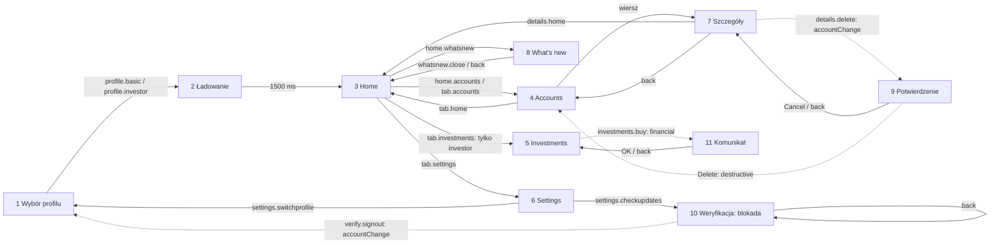

# MapCue.DemoApp: oczekiwana mapa (wyrocznia testów)

Ten dokument opisuje, co eksploracja MapCue powinna znaleźć w aplikacji demo. Używają go STEP-05 (vertical slice), STEP-07 (profile), STEP-09 (blokada) i STEP-10 (scenariusz akceptacyjny). Aplikacja nie ma backendu ani prawdziwych danych. Wszystko jest stałe i w pamięci, a każde uruchomienie zaczyna od wyboru profilu.

Spójność pilnują dwie kontrole:

- `check-consistency.py` sprawdza, że każde `AutomationId` z kodu jest opisane tutaj, a flow `.tapcue/` używają tylko istniejących `AutomationId`;
- `tests/MapCue.Application.Tests/Agent/DemoAppRiskOracleTests.cs` sprawdza tabelę „Ryzyko akcji” klasyfikatorem MapCue.

Przejścia potwierdzają na emulatorze flow `tour-basic.yaml` i `tour-investor.yaml` (job `demo-app.yml`).

## Jak MapCue widzi aplikację (Android)

- MAUI w .NET 10 zapisuje na Androidzie `AutomationId` jako `resource-id` widoku: `com.mapcue.demoapp:id/<AutomationId>`. `content-desc` (`accessibilityText`) zostaje pusty. Potwierdza to hierarchia z emulatora (job `android-smoke`, run 40333292191, ekran wyboru profilu: `com.mapcue.demoapp:id/profile.basic`, `…/scenario.empty`, `…/screen.profile`). Na iOS `AutomationId` to `accessibilityIdentifier` (nie sprawdzone na symulatorze).
- MapCue kluczuje więc elementy po `resource-id` (`elementKey = id:com.mapcue.demoapp:id/<AutomationId>`, siła `ResourceId`). Tytuły ekranów (`screen.*`) są nieinteraktywnymi kotwicami z `resource-id`, więc wchodzą do `identityHash`. Etykieta elementu to jego tekst (np. „Basic”).
- Klasyfikator ryzyka czyta słowa z tekstu i z `resource-id` (`details.delete` daje słowa `details`, `delete`).
- Wiersze list (rachunki, fundusze) nie mają `AutomationId`, więc nie mają `resource-id`. Ich tekst zawiera kwoty i jest maskowany.
- Selektory w flow: `id: "(.*/)?<AutomationId>"` (regex całego `resource-id`; pasuje do formy Androida z pakietem i do identyfikatora iOS). Wiersze i przyciski `AlertDialog` wybierane są tekstem.
- MAUI ustawia też własne identyfikatory kontenerów (`navigation_layout`, `navigationlayout_content`, `action_bar_root`). To stabilne kotwice wspólne dla wszystkich ekranów.
- Dokładne fingerprinty (`identityHash`) nie są tu przypięte. Kalibracja progów na nagraniach z tej aplikacji to zadanie STEP-05 (R-04). Hierarchie ekranu Home po setupie obu profili są w [`recordings/`](recordings/) (oraz w artefakcie `demo-android-flows` każdego runu).

## Profile i scenariusze

| Profil / scenariusz | Wybór (setup) | Rachunki | Zakładka Investments |
|---|---|---|---|
| `basic` | `setup-basic.yaml`: `profile.basic` | 2: Everyday, Savings | brak w drzewie UI |
| `investor` | `setup-investor.yaml`: `profile.investor` | 3: Everyday, Savings, Brokerage | jest (`tab.investments`) |
| `basic` + pusty | `setup-basic-empty.yaml`: `scenario.empty` (przełącznik), potem `profile.basic` | 0, widoczny `accounts.empty` | brak |

Przełącznik `scenario.empty` działa też z profilem `investor` (wtedy 0 rachunków, zakładka Investments jest).

## Ekrany i stany

Znacznik ekranu to tytuł (`Label`) z `AutomationId` `screen.*` (na Androidzie `resource-id`). Kolumna „stateKind” podaje dyskryminator, którego oczekujemy od normalizacji MapCue.

| # | Ekran logiczny | Znacznik | Elementy interaktywne (`AutomationId` / tekst) | Stany (`stateKind`) |
|---|---|---|---|---|
| 1 | Wybór profilu | `screen.profile` | `scenario.empty` (przełącznik), `profile.basic`, `profile.investor` | `default` |
| 2 | Ładowanie | `screen.loading` | brak; `loading.indicator` (ActivityIndicator, rola `progress`) | `loading`, stan przejściowy, 1500 ms (`DemoData.LoadingDelay`) |
| 3 | Home (zakładka) | `screen.home` | `home.accounts`, `home.whatsnew`, pasek zakładek | `default` |
| 4 | Accounts (zakładka) | `screen.accounts` | wiersze rachunków (przyciski bez `AutomationId`, tekst `<nazwa> · PLN <kwota>`) w `accounts.list`, pasek zakładek | z danymi: `default`, lista `many`; pusty: `accounts.empty` widoczny, lista bez wierszy |
| 5 | Investments (zakładka, tylko `investor`) | `screen.investments` | `investments.buy`; wiersze funduszy (etykiety, nieinteraktywne) w `investments.list`, pasek zakładek | `default`, lista `many` |
| 6 | Settings (zakładka) | `screen.settings` | `settings.notifications` (przełącznik, domyślnie włączony), `settings.checkupdates`, `settings.switchprofile`, pasek zakładek | `default` |
| 7 | Szczegóły rachunku | `screen.details` | `details.home`, `details.delete`, „Navigate up” (pasek nawigacji); teksty `details.name`, `details.balance` | `default` |
| 8 | What's new (strona modalna) | `screen.whatsnew` | `whatsnew.close` | strona modalna MAUI (nie `AlertDialog`), więc `modal` z normalizacji nie jest gwarantowany |
| 9 | Potwierdzenie usunięcia (`AlertDialog`) | tytuł „Delete this account?” | „Delete”, „Cancel” | `modal` (systemowe `android:id/alertTitle`, `buttonPanel`) |
| 10 | Weryfikacja (nieznany popup, blokada) | `screen.verify` | `verify.sendcode`, `verify.signout`; tekst `verify.status` | strona modalna, `back` ignorowany |
| 11 | Komunikat zakupu (`AlertDialog`) | tytuł „Demo” | „OK” | `modal` |

Pasek zakładek: `tab.home`, `tab.accounts`, `tab.investments` (tylko `investor`), `tab.settings`. Zakładka zmienia treść tej samej strony, więc Home, Accounts, Investments i Settings różnią się zbiorem elementów, a pasek jest wspólny.

Każdy rachunek ma te same szczegóły (ekran 7). Szczegóły różnych rachunków to ten sam ekran logiczny z inną treścią tekstów (nazwa i kwota). Treść jest maskowana albo nieinteraktywna, więc nie powinna dawać nowych stanów.

## Przejścia

Ryzyko to klasa, którą daje regułowy klasyfikator MapCue (`RiskClassifier`, bez reguł operatora). Przy domyślnej polityce `safe`/`navigational` są dozwolone, a reszta jest pomijana albo wymaga zgody (`PolicyGate`).

| Z | Akcja | Do | Ryzyko | Profile | Uwagi |
|---|---|---|---|---|---|
| 1 Wybór profilu | tap `profile.basic` | 2 Ładowanie → 3 Home | navigational | — | ustawia profil `basic` |
| 1 Wybór profilu | tap `profile.investor` | 2 Ładowanie → 3 Home | navigational | — | ustawia profil `investor` |
| 1 Wybór profilu | tap `scenario.empty` | 1 (przełącznik) | stateChanging | — | tylko flow setupu |
| 2 Ładowanie | (czas, 1500 ms) | 3 Home | — | oba | bez akcji użytkownika |
| 3 Home | tap `home.accounts` | 4 Accounts | navigational | oba | cykl Home ↔ Accounts |
| 3 Home | tap `home.whatsnew` | 8 What's new | navigational | oba | modal |
| 8 What's new | tap `whatsnew.close` | 3 Home | navigational | oba | |
| 8 What's new | back | 3 Home | safe | oba | |
| 3–6 dowolna zakładka | tap `tab.home` / `tab.accounts` / `tab.settings` | 3 / 4 / 6 | navigational | oba | cykle między zakładkami |
| 3–6 dowolna zakładka | tap `tab.investments` | 5 Investments | navigational | tylko `investor` | w `basic` element nie istnieje |
| 4 Accounts | tap wiersz rachunku | 7 Szczegóły | navigational | oba (nie w pustym) | |
| 7 Szczegóły | tap `details.home` | 3 Home | navigational | oba | cykl Details → Home |
| 7 Szczegóły | back / „Navigate up” | 4 Accounts | safe / navigational | oba | |
| 7 Szczegóły | tap `details.delete` | 9 Potwierdzenie | accountChange | oba | akcja ryzykowna, polityka nie powinna jej wykonać |
| 9 Potwierdzenie | tap „Cancel” / back | 7 Szczegóły | navigational / safe | oba | |
| 9 Potwierdzenie | tap „Delete” | 4 Accounts (rachunek usunięty do restartu) | destructive | oba | tylko za zgodą kategorii |
| 5 Investments | tap `investments.buy` | 11 Komunikat zakupu | financial | tylko `investor` | nic nie jest kupowane |
| 11 Komunikat zakupu | tap „OK” / back | 5 Investments | navigational / safe | tylko `investor` | |
| 6 Settings | tap `settings.notifications` | 6 (przełącznik) | stateChanging | oba | |
| 6 Settings | tap `settings.checkupdates` | 10 Weryfikacja | navigational | oba | wejście w blokadę wygląda bezpiecznie |
| 6 Settings | tap `settings.switchprofile` | 1 Wybór profilu | navigational | oba | cykl do początku |
| 10 Weryfikacja | back | 10 Weryfikacja (bez zmiany) | safe | oba | blokada |
| 10 Weryfikacja | tap `verify.sendcode` | 10 (tekst `verify.status`) | communication | oba | nic nie jest wysyłane |
| 10 Weryfikacja | tap `verify.signout` | 1 Wybór profilu | accountChange | oba | |
| 3 Home / 4 / 5 / 6 | back | wyjście z aplikacji (launcher) | safe | oba | koniec stosu nawigacji |
| 1 Wybór profilu | back | wyjście z aplikacji | safe | — | |

## Różnice profili

- `investor` ma zakładkę `tab.investments` i ekran 5. W `basic` nie ma tego elementu w drzewie (nie jest tylko ukryty). Guard `investments` z STEP-07 przechodzi z `inferred` do `observed` dopiero po eksploracji obu profili. Profil `investor` deklaruje capability `investments` (`mapcue.demo.yaml`), a `mapcue status --profiles` pokazuje guard.
- Zakładka zmienia zbiór tokenów tożsamości ekranów z paskiem: Home 6/7 ≈ 0,857, Accounts 5/6 ≈ 0,83, Settings 7/8 ≈ 0,875. Accounts jest poniżej `τ_state`, więc MapCue rozpoznaje te ekrany jako warianty profilu regułą `identity.profileVariantMaxDelta` (ADR-0006, STEP-07). Oczekiwanie: jeden stan na znacznik ekranu w obu profilach.
- Przycisk drugiego profilu na ekranie wyboru to zmiana profilu (`switchElements`, `policy.profileSwitch: deny`): w `basic` `profile.investor` nie jest wykonywany, a w `investor` `profile.basic`.
- Accounts: `basic` ma 2 wiersze, `investor` 3. Oba dają ten sam `countBucket` (`many`), więc to ten sam stan. Scenariusz pusty daje inny stan (bez wierszy, `accounts.empty`).
- Wspólne dla obu: ekrany 1–4 i 6–10, wszystkie cykle i blokada.

## Akcje ryzykowne (test polityki)

| Akcja | Ryzyko MapCue | Oczekiwanie przy domyślnej polityce |
|---|---|---|
| `details.delete` | accountChange | `RequiresApproval` (profil `disposable`) albo `SkippedByPolicy` (`shared-readonly`); nie wykonana |
| „Delete” w potwierdzeniu | destructive | jak wyżej; osiągalne tylko po zgodzie na `details.delete` |
| `investments.buy` | financial | jak wyżej |
| `verify.sendcode` | communication | jak wyżej |
| `verify.signout` | accountChange | jak wyżej |
| `settings.notifications`, `scenario.empty` | stateChanging | tylko przy `disposable` |

## Blokada (nieznany popup)

Settings → `settings.checkupdates` nie sprawdza aktualizacji, tylko pokazuje „Verify your identity” (`screen.verify`). Popup:

- nie jest zapowiedziany na żadnym ekranie;
- ignoruje systemowe `back` (`OnBackButtonPressed` zwraca `true`; na iOS pełny ekran bez gestu zamknięcia);
- ma tylko akcje ryzykowne (`verify.sendcode` communication, `verify.signout` accountChange).

Bez zgody operatora eksploracja nie ma bezpiecznego wyjścia, więc oczekiwany wynik to `Blocked` z `resume.md` (STEP-09). Zadania z innych ekranów nie są tym zablokowane, bo wymagają tylko ponownego uruchomienia aplikacji.

## Graf

Linie przerywane to akcje ryzykowne (poza domyślną polityką).

## Ryzyko akcji

Tabela czytana przez `DemoAppRiskOracleTests`: element (rola, `AutomationId`, czyli `resource-id` `com.mapcue.demoapp:id/<AutomationId>`, i tekst) i klasa, którą musi dać `RiskClassifier` dla `tap`.

<!-- risk-oracle:begin -->
| Rola | AutomationId | Tekst | Ryzyko |
|---|---|---|---|
| button | profile.basic | Basic | navigational |
| button | profile.investor | Investor | navigational |
| toggle | scenario.empty | | stateChanging |
| button | tab.home | Home | navigational |
| button | tab.accounts | Accounts | navigational |
| button | tab.investments | Investments | navigational |
| button | tab.settings | Settings | navigational |
| button | home.accounts | View accounts | navigational |
| button | home.whatsnew | What's new | navigational |
| button | whatsnew.close | Close | navigational |
| button | | Everyday account · PLN 1,250.00 | navigational |
| button | | Brokerage account · PLN 52,310.75 | navigational |
| button | details.home | Home | navigational |
| button | details.delete | Delete account | accountChange |
| button | | Delete | destructive |
| button | | Cancel | navigational |
| button | investments.buy | Buy units | financial |
| button | | OK | navigational |
| toggle | settings.notifications | | stateChanging |
| button | settings.checkupdates | Check for updates | navigational |
| button | settings.switchprofile | Switch profile | navigational |
| button | verify.sendcode | Send code | communication |
| button | verify.signout | Sign out | accountChange |
<!-- risk-oracle:end -->

## Elementy z `AutomationId` (pełna lista)

Ekrany: `screen.profile`, `screen.loading`, `screen.home`, `screen.accounts`, `screen.details`, `screen.investments`, `screen.settings`, `screen.whatsnew`, `screen.verify`.

Elementy: `profile.basic`, `profile.investor`, `scenario.empty`, `loading.indicator`, `tab.home`, `tab.accounts`, `tab.investments`, `tab.settings`, `home.accounts`, `home.whatsnew`, `whatsnew.close`, `accounts.list`, `accounts.empty`, `details.name`, `details.balance`, `details.home`, `details.delete`, `investments.list`, `investments.buy`, `settings.notifications`, `settings.checkupdates`, `settings.switchprofile`, `verify.sendcode`, `verify.signout`, `verify.status`.
